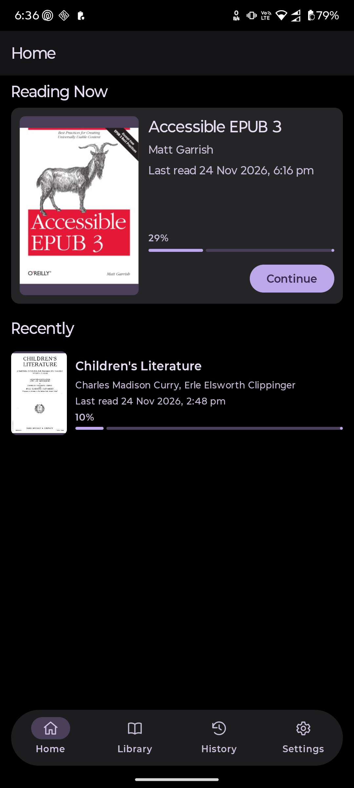
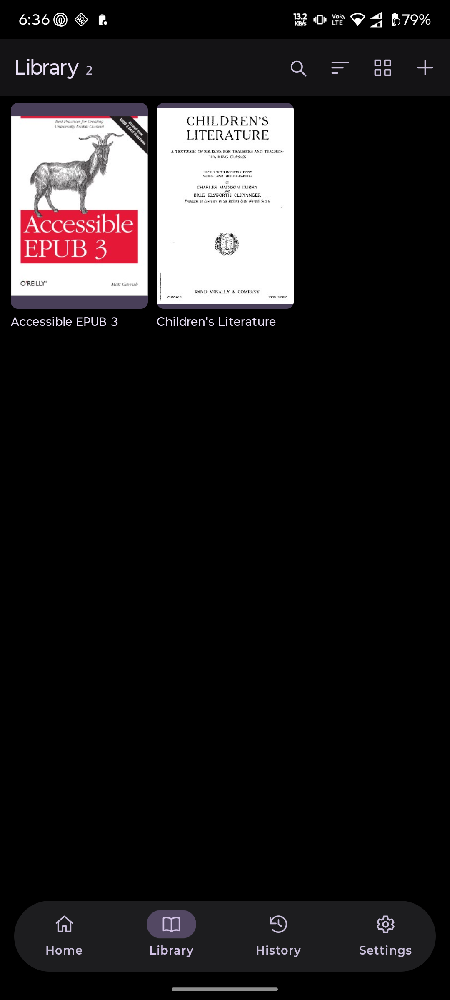
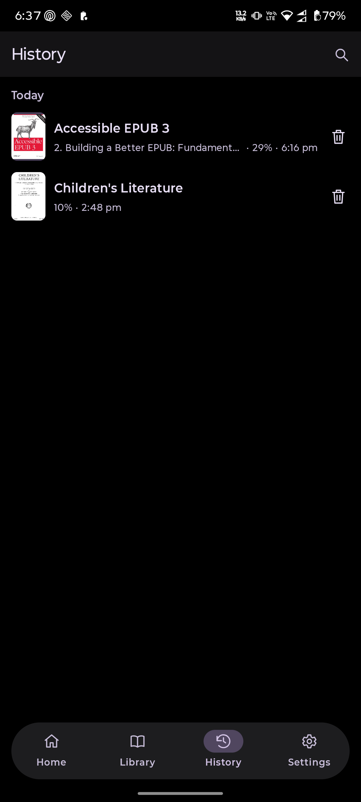
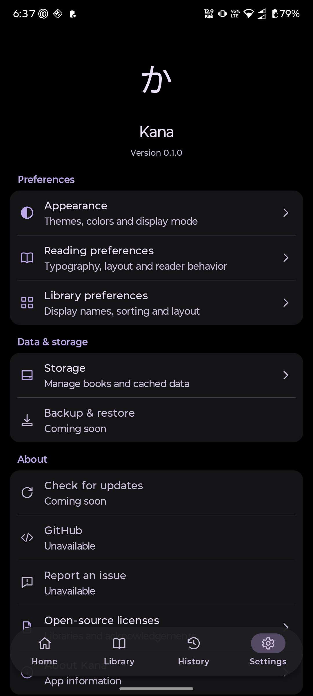
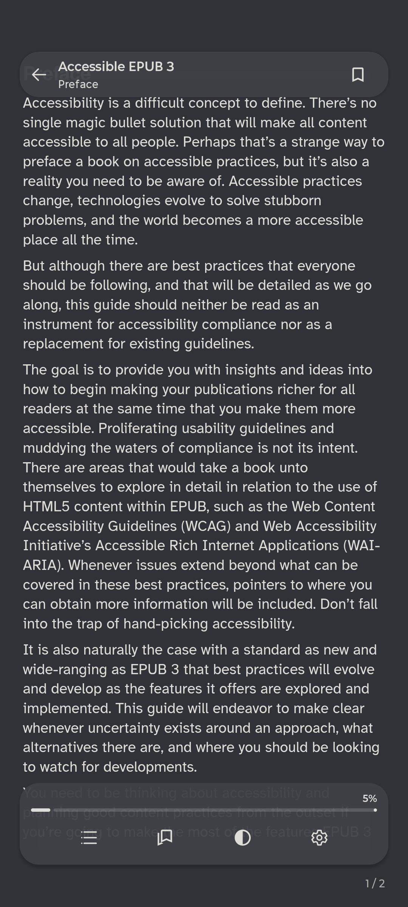

<p align="center">
  
</p>

<p align="center">
  <strong>Kana</strong>
</p>

<p align="center">
  Free and open-source EPUB reader for Android.
</p>

<p align="center">
  <a href="LICENSE"></a>
  <a href="https://kotlinlang.org/"></a>
</p>

## Download

Minimum supported Android version: API 24 (Android 7.0 Nougat).

Releases are published on [GitHub Releases](https://github.com/Artemisdevv/Kana/releases).

## Screenshots

<p align="center">
  
  
  
  
  
</p>

## Features

- Import DRM-free EPUBs through the system file picker
- Deduplication: byte-identical books share one Library entry
- Library in grid or list view, with search and sort
- Continue reading from Home and reading history
- Paginated reading and continuous scrolling
- Table of contents and bookmarks
- Highlights with notes, colors, copy, and dictionary lookup
- Customizable fonts, sizes, spacing, margins, and alignment
- Reader themes, fullscreen mode, and page numbers
- System light/dark theme and Material You colors
- Offline dictionary (WordNet) and online dictionary (Wiktionary)
- Export books to a directory

## Building from source

Use JDK 17 and install Android SDK Platform 37.0 and Android SDK Build-Tools 36.0.0. Set `ANDROID_HOME` to the SDK directory or open this project in Android Studio and let it configure the local SDK path. The app supports API 24 and up and targets API 36.

On Windows:

```powershell
.\gradlew.bat :app:assembleDebug :app:testDebugUnitTest :app:lintDebug
```

On macOS or Linux:

```bash
./gradlew :app:assembleDebug :app:testDebugUnitTest :app:lintDebug
```

The debug APK is at `app/build/outputs/apk/debug/app-debug.apk`.

Release signing requires a keystore. Create `keystore.properties` (ignored by `.gitignore`) with your signing credentials and wire it into the release `signingConfig` before building release variants.

See [ARCHITECTURE.md](docs/ARCHITECTURE.md) for developer documentation.

## Contributing

Report bugs and suggest improvements using [GitHub Issues](https://github.com/Artemisdevv/Kana/issues).

## Credits

- [Readium Kotlin Toolkit](https://github.com/readium/kotlin-toolkit) (BSD-3-Clause) — EPUB parsing and navigation
- [AndroidX / Jetpack](https://developer.android.com/jetpack) (Apache-2.0) — Compose, Room, DataStore, and other libraries
- [Kotlin](https://kotlinlang.org/) (Apache-2.0) — programming language
- [WordNet 3.0](https://wordnet.princeton.edu/) (Princeton University license) — offline dictionary data
- [Wiktionary](https://dictionaryapi.dev/) (CC BY-SA) — online dictionary lookups
- Bundled fonts (SIL Open Font License 1.1): Inter, JetBrains Mono, Lora, Literata, Atkinson Hyperlegible
- OpenDyslexic (CC BY 3.0 and Bitstream)
- [Noto Sans CJK JP](https://fonts.google.com/noto/specimen/Noto+Sans+CJK+JP) (SIL Open Font License 1.1) — launcher icon glyph

See `app/src/main/assets/licenses/` and the bundled font `OFL.txt` files for license texts.

## License

[GPL-3.0-only](LICENSE)

Copyright (C) 2026 Artemisdevv.

Distributed modified versions of Kana must comply with GPLv3: the entire work must be licensed under GPLv3, corresponding source code must be made available to recipients, and modified versions must be marked as changed. This license does not permit incorporating Kana into proprietary programs.
